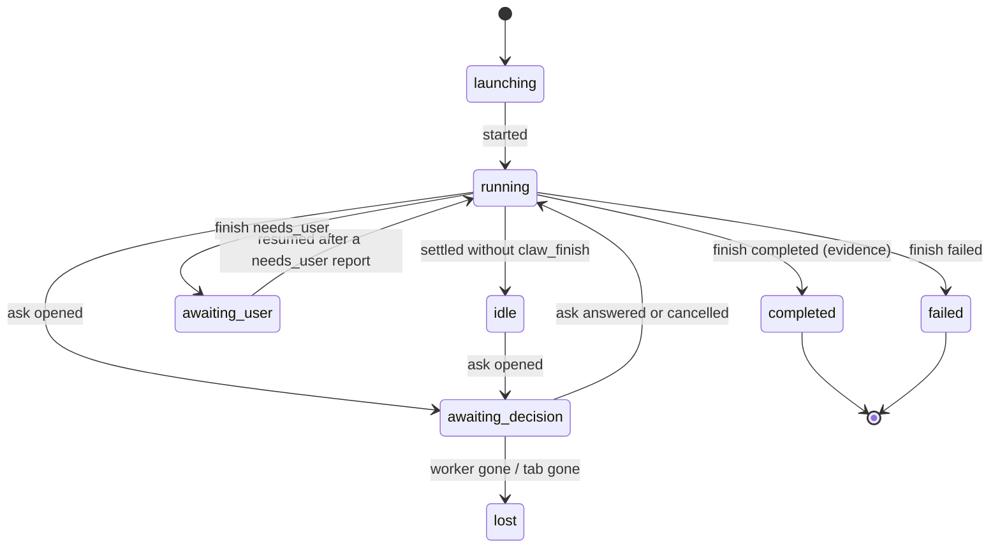

# Worker-local clarification (TREBOL-308)

A Claw worker that needs a decision asks the user **in its own tab** and continues the same run with the answer. The
orchestrator does not relay answers and no second run, issue or tab is created.

Code: `extensions/claw/extension.ts` (`registerWorker`), `.pi/lib/claw/child.ts` (`askFromStarted`,
`askFromCompleted`, `recordAsk`, `recordResumed`), `.pi/lib/claw/daemon.ts` (`applyEvent`, `reconcileRun`,
`handleRequest`), `.pi/lib/claw/spawn.ts` (`taskFile`).
Tests: `.pi/test/claw/clarification.test.ts` (16 tests).

## Why the worker's own tab works

The launcher runs a worker as plain terminal pi: `workerCommand` sets `PI_TERN_UI=0`, which is the documented bypass of
the Tern TSP frontend (`docs/reference/tern-pi-shell-dispatch.md`). Native Pi keeps its own TUI, so
`ctx.hasUI === true`, and `ask_user_question` (registered by `extensions/ask-user`) renders its normal modal in that
block. The answer is returned to the same Pi session as the tool result, so the turn resumes in the same run.

The Tern TSP route is the opposite case: it has unbound extension UI and answers asks only through the remote-ask
bridge (`.pi/lib/tern/bridge.ts`, `.pi/lib/tern/ask-dialog.ts`). A worker does not run that route, and no local bridge is
installed in it. If a worker ever lacks a modal, the fallback below is the only path.

| Surface | Where the modal appears | Answer path |
| --- | --- | --- |
| Worker tab (`PI_TERN_UI=0`) | that block, native Pi ask UI | keys/taps in that block -> tool result -> same turn |
| Tern TSP pane (not a worker) | Tern overlay via the ask dialog bridge | remote-ask events |

## Worker events

The worker process is the only writer of its own events file; the daemon applies them.

```jsonc
{"eid":"evt-…","type":"ask","at":"…","runId":"run-…","ask":{"flowId":"tool:…","title":"Branch","questionIds":["branch"],"state":"opened"}}
{"eid":"evt-…","type":"ask","at":"…","runId":"run-…","ask":{"flowId":"tool:…","questionIds":["branch"],"state":"answered"}}
{"eid":"evt-…","type":"ask","at":"…","runId":"run-…","ask":{"flowId":"tool:…","questionIds":["branch"],"state":"cancelled"}}
{"eid":"evt-…","type":"resumed","at":"…","runId":"run-…"}
```

- `ask` is derived from `@eko24ive/pi-ask:started` / `@eko24ive/pi-ask:completed` only. A malformed event without a
  flow id is ignored, so it cannot change a run.
- Only the flow id, title and question ids are stored. Answer values never reach `runs/<id>.json` or the events file.
- `cancelled` comes from `result.cancelled === true`; an answer is never inferred to be a cancel.
- `resumed` is written when a new agent turn starts in the same process after this worker already called `claw_finish`.

## Run state



`awaiting_decision` exists so the daemon never merges "a human must answer in the worker's tab" with the terminal
`needs_user` report (`awaiting_user`).

## Fallback contract

The worker's task file (`taskFile`) tells it, in this order:

1. Ask with `ask_user_question` before ending a turn that needs a decision. The answer resumes the same run.
2. Do not loop and do not invent a question.
3. If the modal was cancelled, unavailable, or the tool is missing, call `claw_finish needs_user` with a summary stating
   the exact question, the options, and what each answer would change.

For **legacy** runs that already reported `needs_user`:

- The report stands; the daemon never converts a summary into a question.
- The worker tab stays open (tabs are launched with `--keep-open`). Answering there starts a new turn in the same
  process, which writes `resumed` and puts the run back to `running`; a later `claw_finish` supersedes the earlier one.
- `claw_send` is never a relay for a question: it is refused while a modal is open so nothing types into the dialog.
  A legacy `awaiting_user` run is resumed by input in its own live tab: the human answers there, or `claw_send`
  reactivates the run when that tab is live and delivers the human's text as ordinary input. Reactivation is not an
  answer to a modal, and the modal refusal above is checked first.
- If the daemon has already idle-exited (120 s with no active work), it applies the new events on its next start; the
  run file is untouched meanwhile.

## Guards preserved

- Completion still needs evidence (`validateFinish`); a `needs_user` report cannot complete a run.
- Depth 1 is unchanged: `WORKER_BLOCKED_TOOLS` still blocks agent-spawning tools. `ask_user_question` is not an
  agent-spawning tool, and it is already exempt from task enforcement as a user-interaction tool
  (`.pi/lib/runtime/swarm-toolclass.ts`), so no guard was weakened.
- An open modal is visible to the orchestrator (`statusSummary().awaitingDecision`, `claw_read`), but the orchestrator
  has no tool that answers it.

## Verification

Simulated (unit tests, fake Tern and fake Hoja, deterministic clock):

- open question -> `awaiting_decision`, inbox points at the worker's tab, `statusSummary` separates it from
  `awaitingUser`;
- answered -> `running` -> `completed` with one issue, one tab and one run;
- cancelled -> `running`, then `needs_user` -> `awaiting_user` with the worker's summary;
- cancelled then a silent turn -> `idle` with the "cancelled its own question" note, never a wait and never a result;
- a settled turn with no closing ask event -> question `unresolved`, `idle`, and nothing in `awaitingDecision`;
- finish with no closing ask event -> question `unresolved`, never "still waiting";
- legacy `needs_user` + `resumed` -> `running` on the same run (one issue, one tab, one create);
- open question past `ASK_STALE_MS` -> one stale reminder, run still active;
- worker death with an open question -> `lost` with that reason;
- `claw_send` refused while a modal is open (no keystrokes sent to the block);
- worker extension records ask opened/answered/cancelled and a single `resumed`, and writes no answer content.

Not verified live: a real Tern worker tab rendering the modal, a human answering it, and the daemon applying the
resulting events end to end. That requires a live Tern pane and a spawned worker; it was not run for this change.

## Integration with the daemon changes already on main

This work is rebased on `main`, which already carries the claw process fixes from `fix/claw-daemon-noise` and
`improve/claw-process` (transition-only idle notice, `awaiting_user` reactivation on send, launch timeout, tab close for
ended runs). Three places had to be reconciled, and the merge preserves both behaviors:

1. `handleRequest` `send`: the open-modal refusal is checked **first**, before any `awaiting_user` reactivation, so
   reactivation can never type into a live dialog. The `idle` re-arm after input is untouched.
2. `applyEvent` `settled`: the early return still ignores terminal/awaiting_user/idle settles, but `awaiting_decision`
   is included so a settle there marks the question `unresolved` and moves the run to `idle` instead of stranding it.
   The idle notice keeps main's transition key (`idle:<run>:<settles>`).
3. `store.ts`: `Run.ask` is additive next to `tabClosedAt`/`tabCloseError`.
