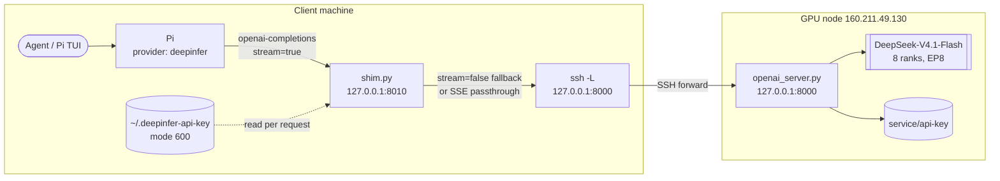

# DeepInfer private DeepSeek endpoint → Pi provider

How to point a Pi coding agent at the private `DeepSeek-V4.1-Flash-1017` server on
`ubuntu@160.211.49.130`. The node binds its API to loopback-only and refuses `stream=true`
on the old adapter, so a client machine needs a **tunnel** plus a **thin local shim**.

Result: provider `deepinfer`, model `deepseek-ai/DeepSeek-V4.1-Flash-1017`, 500K declared
context, thinking level `max`, real token streaming.

Every step below runs **on the client machine where the agent runs**. Nothing here needs
access to the GPU node beyond `ssh` and `curl`.



## 0. Prerequisites

| Need | Check |
| --- | --- |
| `ssh`, `curl`, `python3` (3.10+) | `command -v ssh curl python3` |
| Your public key authorized on the node | step 1 |
| Pi installed, config at `~/.pi/agent/` | `pi --version` |

Pick free local ports. `8000` is the tunnel, `8010` is the shim. **Check 8010 is free first** —
`ss -ltnp | grep :8010`. If your machine already uses it, pick another and change
`DEEPINFER_SHIM_PORT` + the `baseUrl` in step 5. Do not pick a port something else already
owns: the shim exits with `OSError: [Errno 98] Address already in use` and every request falls
through to the wrong service.

## 1. Authorize your SSH key on the node

```bash
cat ~/.ssh/id_ed25519.pub
```

Send that line to whoever owns the node, or append it yourself where you already have access:

```bash
ssh ubuntu@160.211.49.130 'mkdir -p ~/.ssh && chmod 700 ~/.ssh && cat >> ~/.ssh/authorized_keys && chmod 600 ~/.ssh/authorized_keys' < ~/.ssh/id_ed25519.pub
```

Verify before going further:

```bash
ssh -o BatchMode=yes ubuntu@160.211.49.130 'echo SSH_OK; hostname'
```

`Permission denied (publickey)` means the key is not installed — stop here.

## 2. Open the tunnel

```bash
ssh -fN \
  -o ExitOnForwardFailure=yes \
  -o ServerAliveInterval=30 \
  -o ServerAliveCountMax=3 \
  -o BatchMode=yes \
  -L 8000:127.0.0.1:8000 \
  ubuntu@160.211.49.130
```

`-fN` backgrounds it; `ExitOnForwardFailure=yes` makes it fail loudly if the port is taken.
Confirm with `ss -ltn | grep 127.0.0.1:8000`.

Stop it later with:

```bash
pkill -f '^ssh -fN.*-L 8000:127\.0\.0\.1:8000'
```

The `^ssh` anchor matters: an unanchored `pkill -f` pattern also matches the shell running the
command and kills your own session.

## 3. Mirror the API key

The key is generated by the node's `start-api.sh` and lives at
`/scratch/deepinfer-ubuntu/service/api-key`. Never paste it into a prompt, a commit or
`models.json`.

```bash
umask 077
ssh ubuntu@160.211.49.130 'cat /scratch/deepinfer-ubuntu/service/api-key' > "$HOME/.deepinfer-api-key"
chmod 600 "$HOME/.deepinfer-api-key"
wc -c < "$HOME/.deepinfer-api-key"   # expect ~69 bytes, starts with dsk_
```

If that file is missing, the service has never started on the node — run
`bash /scratch/deepinfer-ubuntu/deploy-staging/start-api.sh` there (it creates the key, then
loads the model; ~7 minutes to ready).

## 4. Install the shim

Save this as `~/.local/share/deepinfer-shim/shim.py`. It accepts Pi's streaming request,
normalises `reasoning_effort` into the dialect the model's encoder accepts, forces
`thinking_mode`, pipes the upstream SSE through when the server streams, and synthesises an
SSE stream from a plain JSON completion when it does not.

```python
#!/usr/bin/env python3
"""SSE shim for the DeepInfer non-streaming OpenAI adapter.

Pi's `openai-completions` provider always sends stream=true
(buildParams hardcodes `stream:!0`), but openai_server.py raises
"stream=true is not supported by this adapter". This process accepts the
streaming request on 127.0.0.1:8001, calls the upstream with stream=false,
and re-emits the single completion as a well-formed SSE stream:

    role chunk -> (reasoning_content) -> (content) -> (tool_calls)
    -> finish_reason -> usage -> [DONE]

The API key is read from DISK on every request so restarting the upstream
(which regenerates the key) needs no shim restart.
"""
from __future__ import annotations

import json
import os
import sys
import time
import urllib.error
import urllib.request
from http.server import BaseHTTPRequestHandler, ThreadingHTTPServer

UPSTREAM = os.environ.get("DEEPINFER_UPSTREAM", "http://127.0.0.1:8000").rstrip("/")
KEY_FILE = os.environ.get("DEEPINFER_KEY_FILE", os.path.expanduser("~/.deepinfer-api-key"))
BIND = os.environ.get("DEEPINFER_SHIM_BIND", "127.0.0.1")
PORT = int(os.environ.get("DEEPINFER_SHIM_PORT", "8010"))
DEFAULT_THINKING = os.environ.get("DEEPINFER_SHIM_THINKING", "chat")
THINKING_SUFFIX = "-thinking"
EFFORT_ALIASES = {"minimal": "low", "low": "low", "medium": "high", "high": "high",
                  "xhigh": "max", "max": "max"}
TIMEOUT = float(os.environ.get("DEEPINFER_SHIM_TIMEOUT", "3600"))


def api_key() -> str:
    try:
        with open(KEY_FILE, "r", encoding="utf-8") as fh:
            return fh.read().strip()
    except OSError:
        return ""


def open_upstream(body: dict):
    """POST /v1/chat/completions and keep the response object so SSE can be piped."""
    data = json.dumps(body, ensure_ascii=False).encode()
    req = urllib.request.Request(UPSTREAM + "/v1/chat/completions", data=data, method="POST")
    req.add_header("Authorization", "Bearer " + api_key())
    req.add_header("Content-Type", "application/json")
    req.add_header("Accept", "text/event-stream")
    try:
        return urllib.request.urlopen(req, timeout=TIMEOUT), None
    except urllib.error.HTTPError as exc:
        raw = exc.read()
        try:
            return None, (exc.code, json.loads(raw or b"{}"))
        except ValueError:
            return None, (exc.code, {"error": {"message": raw.decode("utf-8", "replace") or str(exc)}})
    except (urllib.error.URLError, TimeoutError, ConnectionError) as exc:
        return None, (502, {"error": {"message": f"upstream unreachable: {exc}", "type": "shim_error"}})


def upstream(path: str, method: str = "GET", body: dict | None = None):
    data = None if body is None else json.dumps(body, ensure_ascii=False).encode()
    req = urllib.request.Request(UPSTREAM + path, data=data, method=method)
    req.add_header("Authorization", "Bearer " + api_key())
    req.add_header("Accept", "application/json")
    if data is not None:
        req.add_header("Content-Type", "application/json")
    try:
        with urllib.request.urlopen(req, timeout=TIMEOUT) as resp:
            return resp.status, json.loads(resp.read() or b"{}")
    except urllib.error.HTTPError as exc:
        raw = exc.read()
        try:
            return exc.code, json.loads(raw or b"{}")
        except ValueError:
            return exc.code, {"error": {"message": raw.decode("utf-8", "replace") or str(exc)}}
    except (urllib.error.URLError, TimeoutError, ConnectionError) as exc:
        return 502, {"error": {"message": f"upstream unreachable: {exc}", "type": "shim_error"}}


def sse_payloads(completion: dict):
    """Turn one non-streamed completion into the chunk sequence Pi expects."""
    cid = completion.get("id") or "chatcmpl-shim"
    model = completion.get("model") or ""
    created = completion.get("created") or int(time.time())
    choices = completion.get("choices") or [{}]
    message = choices[0].get("message") or {}

    def chunk(delta, finish=None):
        return {
            "id": cid,
            "object": "chat.completion.chunk",
            "created": created,
            "model": model,
            "choices": [{"index": 0, "delta": delta, "finish_reason": finish}],
        }

    yield chunk({"role": "assistant", "content": ""})
    if message.get("reasoning_content"):
        yield chunk({"reasoning_content": message["reasoning_content"]})
    if message.get("content"):
        yield chunk({"content": message["content"]})
    for index, call in enumerate(message.get("tool_calls") or []):
        fn = call.get("function") or {}
        args = fn.get("arguments")
        if not isinstance(args, str):
            args = json.dumps(args or {}, ensure_ascii=False)
        yield chunk({
            "tool_calls": [{
                "index": index,
                "id": call.get("id") or f"call_{index}",
                "type": "function",
                "function": {"name": fn.get("name") or "", "arguments": args},
            }]
        })
    yield chunk({}, choices[0].get("finish_reason") or "stop")
    usage = completion.get("usage")
    if usage:
        yield {
            "id": cid,
            "object": "chat.completion.chunk",
            "created": created,
            "model": model,
            "choices": [],
            "usage": usage,
        }


class Handler(BaseHTTPRequestHandler):
    server_version = "DeepInferSSEShim/1.0"
    protocol_version = "HTTP/1.1"

    def log_message(self, fmt, *args):
        sys.stderr.write("%s - %s\n" % (self.log_date_time_string(), fmt % args))

    def _json(self, status: int, payload: dict):
        raw = json.dumps(payload, ensure_ascii=False).encode()
        self.send_response(status)
        self.send_header("Content-Type", "application/json")
        self.send_header("Content-Length", str(len(raw)))
        self.send_header("Cache-Control", "no-store")
        self.end_headers()
        self.wfile.write(raw)

    def do_GET(self):
        if self.path in ("/health", "/v1/models"):
            status, payload = upstream(self.path)
            return self._json(status, payload)
        return self._json(404, {"error": {"message": "not found"}})

    def do_POST(self):
        if self.path != "/v1/chat/completions":
            return self._json(404, {"error": {"message": "not found"}})
        try:
            length = int(self.headers.get("Content-Length", "0"))
            body = json.loads(self.rfile.read(length) or b"{}")
        except (ValueError, json.JSONDecodeError) as exc:
            return self._json(400, {"error": {"message": f"bad request body: {exc}"}})

        wants_stream = bool(body.pop("stream", False))
        body.pop("stream_options", None)
        model = str(body.get("model") or "")

        # The model encoder only accepts low/high/max or an int in [1,100]; Pi can
        # send minimal/medium/xhigh, which trips an assert (400) even in chat mode.
        effort = body.get("reasoning_effort")
        effort_active = False
        if isinstance(effort, str):
            norm = effort.strip().lower()
            if norm in ("", "off", "none", "disabled"):
                body.pop("reasoning_effort", None)
            else:
                norm = EFFORT_ALIASES.get(norm, norm)
                body["reasoning_effort"] = norm if norm in EFFORT_ALIASES.values() else "high"
                effort_active = True
        elif isinstance(effort, int) and not isinstance(effort, bool):
            body["reasoning_effort"] = min(100, max(1, effort))
            effort_active = True
        elif effort is not None:
            body.pop("reasoning_effort", None)

        # The effort prefix is only rendered in thinking mode, so an effort
        # request implies thinking; the -thinking suffix forces it.
        if model.endswith(THINKING_SUFFIX) or effort_active:
            body["thinking_mode"] = "thinking"
        elif "thinking_mode" not in body:
            body["thinking_mode"] = DEFAULT_THINKING

        self.log_message(
            "forward model=%s thinking=%s effort=%s stream=%s",
            model or "-", body.get("thinking_mode"), body.get("reasoning_effort", "-"), wants_stream,
        )
        if not wants_stream:
            status, payload = upstream("/v1/chat/completions", "POST", body)
            if status != 200 or "error" in payload:
                return self._json(status if status != 200 else 502, payload)
            return self._json(200, payload)

        # Streaming: prefer the upstream's own SSE and pipe it through untouched.
        resp, err = open_upstream({**body, "stream": True})
        if err is not None:
            status, payload = err
            message = json.dumps(payload)
            if status == 400 and "stream" in message:
                # Upstream without streaming support: fall back to buffering.
                status, payload = upstream("/v1/chat/completions", "POST", body)
                if status != 200 or "error" in payload:
                    return self._json(status if status != 200 else 502, payload)
                return self._emit_synthesized(payload)
            return self._json(status, payload)
        content_type = (resp.headers.get("Content-Type") or "").lower()
        if "text/event-stream" not in content_type:
            try:
                payload = json.loads(resp.read() or b"{}")
            finally:
                resp.close()
            if "error" in payload:
                return self._json(502, payload)
            return self._emit_synthesized(payload)
        self._pipe_sse(resp)

    def _pipe_sse(self, resp):
        self.send_response(200)
        self.send_header("Content-Type", "text/event-stream")
        self.send_header("Cache-Control", "no-cache")
        self.send_header("Connection", "close")
        self.end_headers()
        try:
            while True:
                block = resp.read1(8192)
                if not block:
                    break
                self.wfile.write(block)
                self.wfile.flush()
        except (BrokenPipeError, ConnectionResetError):
            pass
        finally:
            try:
                resp.close()
            except Exception:
                pass
        self.close_connection = True

    def _emit_synthesized(self, payload):
        self.send_response(200)
        self.send_header("Content-Type", "text/event-stream")
        self.send_header("Cache-Control", "no-cache")
        self.send_header("Connection", "close")
        self.end_headers()
        try:
            for chunk in sse_payloads(payload):
                self.wfile.write(b"data: " + json.dumps(chunk, ensure_ascii=False).encode() + b"\n\n")
                self.wfile.flush()
            self.wfile.write(b"data: [DONE]\n\n")
            self.wfile.flush()
        except (BrokenPipeError, ConnectionResetError):
            pass
        self.close_connection = True


def main():
    if not api_key():
        sys.stderr.write(f"warning: no api key readable at {KEY_FILE}\n")
    server = ThreadingHTTPServer((BIND, PORT), Handler)
    sys.stderr.write(f"deepinfer shim listening on http://{BIND}:{PORT} -> {UPSTREAM}\n")
    sys.stderr.flush()
    try:
        server.serve_forever()
    except KeyboardInterrupt:
        pass
    finally:
        server.server_close()


if __name__ == "__main__":
    main()
```

Wrapper scripts next to it:

```bash
mkdir -p ~/.local/share/deepinfer-shim/logs
cat > ~/.local/share/deepinfer-shim/start.sh <<'SH'
#!/usr/bin/env bash
# Start tunnel (8000) + SSE shim (8010). Idempotent.
set -euo pipefail
NODE="${DEEPINFER_NODE:-ubuntu@160.211.49.130}"
DIR="$HOME/.local/share/deepinfer-shim"

if ! ss -ltn 2>/dev/null | grep -qE '127\.0\.0\.1:8000\b'; then
  ssh -fN -o ExitOnForwardFailure=yes -o ServerAliveInterval=30 -o ServerAliveCountMax=3 \
      -o BatchMode=yes -L 8000:127.0.0.1:8000 "$NODE"
  echo "tunnel: started"
else
  echo "tunnel: already up"
fi

if pgrep -f 'deepinfer-shim/shim\.py' >/dev/null; then
  echo "shim: already running pid=$(pgrep -f 'deepinfer-shim/shim\.py' | head -1)"
else
  DEEPINFER_SHIM_PORT="${DEEPINFER_SHIM_PORT:-8010}" DEEPINFER_SHIM_BIND=127.0.0.1 \
    nohup python3 "$DIR/shim.py" >>"$DIR/logs/shim.log" 2>&1 &
  echo $! > "$DIR/shim.pid"
  echo "shim: started pid=$(cat "$DIR/shim.pid")"
fi
SH
cat > ~/.local/share/deepinfer-shim/stop.sh <<'SH'
#!/usr/bin/env bash
# Stop the shim and only this local tunnel. Does not touch the GPU node.
set -uo pipefail
pkill -f 'deepinfer-shim/shim\.py' && echo "shim: stopped" || echo "shim: not running"
for p in $(pgrep -f '^ssh -fN.*-L 8000:127\.0\.0\.1:8000' || true); do kill "$p" && echo "tunnel: stopped pid=$p"; done
SH
chmod +x ~/.local/share/deepinfer-shim/{start,stop}.sh
~/.local/share/deepinfer-shim/start.sh
```

## 5. Configure Pi

Add the provider to `~/.pi/agent/models.json` (back it up first):

```json
{
  "providers": {
    "deepinfer": {
      "baseUrl": "http://127.0.0.1:8010/v1",
      "api": "openai-completions",
      "apiKey": "!bash -lc 'cat \"$HOME/.deepinfer-api-key\"'",
      "models": [
        {
          "id": "deepseek-ai/DeepSeek-V4.1-Flash-1017",
          "name": "DeepSeek V4.1 Flash (DeepInfer 500k)",
          "reasoning": true,
          "input": ["text"],
          "contextWindow": 500000,
          "maxTokens": 32768,
          "thinkingLevelMap": { "off": null, "minimal": "low", "low": "low",
                                "medium": "high", "high": "max", "xhigh": "max", "max": "max" },
          "cost": { "input": 0, "output": 0, "cacheRead": 0, "cacheWrite": 0 },
          "compat": { "supportsStore": false, "supportsDeveloperRole": false,
                      "supportsReasoningEffort": true, "supportsStrictMode": false }
        }
      ]
    }
  }
}
```

Why those fields:

- `apiKey` starting with `!` is executed as a shell command, so the secret stays in a 600 file
  rather than in config.
- `supportsDeveloperRole: false` — the model's encoder expects a `system` message, not
  `developer`.
- `supportsStrictMode: false` — keeps `strict` out of tool schemas.
- `supportsStore: false` — stops Pi sending `store`.
- `thinkingLevelMap` — the encoder accepts only `low`/`high`/`max` (or an int 1–100);
  Pi's `medium` would otherwise produce a 400.

Then make it the default in `~/.pi/agent/settings.json`:

```json
{
  "defaultProvider": "deepinfer",
  "defaultModel": "deepseek-ai/DeepSeek-V4.1-Flash-1017",
  "defaultThinkingLevel": "max",
  "modelThinkingLevels": { "deepinfer/deepseek-ai/DeepSeek-V4.1-Flash-1017": "max" }
}
```

Merge these keys into the existing object — do not replace the file.

## 6. Verify

Run these in order; each must pass before the next.

| # | Command | Expected |
| --- | --- | --- |
| 1 | `curl -sS http://127.0.0.1:8010/health` | `{"status": "ok"}` (not `loading`, not `502`) |
| 2 | `KEY=$(cat ~/.deepinfer-api-key); curl -sS http://127.0.0.1:8000/v1/models -H "Authorization: Bearer $KEY"` | list containing `deepseek-ai/DeepSeek-V4.1-Flash-1017` |
| 3 | non-streaming completion (below) | `"content": "API ready"`, `finish_reason: stop` |
| 4 | streaming completion (below) | several `data:` chunks, then `finish=stop`, usage, `[DONE]` |
| 5 | `pi --list-models deepinfer` | model listed with `500K` context, `thinking yes` |
| 6 | adapter smoke test (below) | `first_delta` well under `total`, non-empty text |

```bash
KEY=$(cat ~/.deepinfer-api-key)
# 3. non-streaming
curl -sS http://127.0.0.1:8010/v1/chat/completions -H "Authorization: Bearer $KEY" \
  -H 'Content-Type: application/json' \
  -d '{"model":"deepseek-ai/DeepSeek-V4.1-Flash-1017","messages":[{"role":"user","content":"Reply with exactly: API ready"}],"max_completion_tokens":32}'

# 4. streaming (count the chunks; first token should arrive before the last)
curl -sS -N http://127.0.0.1:8010/v1/chat/completions -H "Authorization: Bearer $KEY" \
  -H 'Content-Type: application/json' \
  -d '{"model":"deepseek-ai/DeepSeek-V4.1-Flash-1017","stream":true,"messages":[{"role":"user","content":"Write 60 words about caching."}],"max_completion_tokens":120}' \
  | grep -c '^data: '
```

```bash
# 6. adapter smoke test — proves Pi's own code path, not just curl
cat > /tmp/pi-deepinfer-smoke.mjs <<'JS'
import { streamSimple } from '@earendil-works/pi-ai/api/openai-completions';
import { readFileSync } from 'node:fs';
const apiKey = readFileSync(`${process.env.HOME}/.deepinfer-api-key`, 'utf8').trim();
const raw = JSON.parse(readFileSync(`${process.env.HOME}/.pi/agent/models.json`, 'utf8'));
const prov = raw.providers.deepinfer;
const model = { ...prov.models[0], api: prov.api, provider: 'deepinfer', baseUrl: prov.baseUrl };
const ctx = { systemPrompt: 'You are precise.', messages: [{ role: 'user', content: 'Reply exactly: PI OK', timestamp: Date.now() }] };
const t0 = Date.now();
let first = null, deltas = 0, text = '';
for await (const ev of streamSimple(model, ctx, { apiKey, reasoning: 'max' })) {
  if (ev.type === 'text_delta' || ev.type === 'thinking_delta') { deltas++; first ??= Date.now() - t0; }
  if (ev.type === 'done') for (const b of ev.message.content) if (b.type === 'text') text += b.text;
  if (ev.type === 'error') console.log('ERROR', ev.error?.errorMessage);
}
console.log({ deltas, first_delta_ms: first, total_ms: Date.now() - t0, text });
JS
node /tmp/pi-deepinfer-smoke.mjs   # run from a directory that can resolve @earendil-works/pi-ai
```

## Troubleshooting

| Symptom | Cause | Fix |
| --- | --- | --- |
| `502 upstream unreachable` from the shim | service not started, or tunnel down | `ss -ltn \| grep 8000`; re-run `start.sh`; check `/health` on the node |
| `{"status": "loading"}` | model still loading after a restart | wait ~7 min; check `service/logs/api.log` |
| `400 Invalid reasoning effort … medium` | effort reached the encoder unmapped | confirm `thinkingLevelMap` in `models.json`; the shim also normalises |
| `OSError: 98 Address already in use` at shim start | another process owns the port | pick a free port; update `DEEPINFER_SHIM_PORT` and `baseUrl` |
| Header then silence, GPUs idle, next request hangs | an in-flight request was abandoned mid-stream | restart the node service (see below) |
| `Permission denied (publickey)` | key not in `authorized_keys` | step 1 |
| Pi shows the model but 404s | wrong `id` in `models.json` | id must be exactly `deepseek-ai/DeepSeek-V4.1-Flash-1017` |

## Restarting the node service

`kill <pid>` does **not** stop it: the SIGTERM handler deadlocks against `serve_forever` and
the worker ranks keep every GPU's memory. Hard-kill and restart:

```bash
ssh ubuntu@160.211.49.130 '
  pkill -KILL -f "[s]pawn_main"
  kill -KILL "$(cat /scratch/deepinfer-ubuntu/service/api.pid 2>/dev/null)" 2>/dev/null
  rm -f /scratch/deepinfer-ubuntu/service/api.pid
  bash /scratch/deepinfer-ubuntu/deploy-staging/start-api.sh'
```

Wait for `{"status": "ok"}` (~7 min), then re-run verification step 1.

Bracketed patterns (`"[s]pawn_main"`, `"[o]penai_server\.py"`) are deliberate: an unbracketed
`pkill -f` matches the `ssh '…'` command line itself and kills the session mid-run.

## Is streaming actually on?

If you inherit a node running the **old** adapter, `stream=true` returns
`400 stream=true is not supported by this adapter` and the shim silently falls back to
synthesising chunks from a whole completion — Pi works, but tokens appear all at once.

To get real streaming, the adapter must loop `llm_engine.add_request()` +
`step()`/`flush_inflight_reqs()` and emit deltas. Two rules matter:

- `step()` is a **collective**: every worker rank must run the same loop. Route only rank 0
  into the streaming branch and the others leave the loop, so rank 0 blocks forever — you see
  headers, one chunk, then silence and idle GPUs.
- If a client disconnects mid-stream, keep draining the engine request. Abandoning it leaves
  the engine wedged for every later request.

Check whether a node already streams:

```bash
KEY=$(cat ~/.deepinfer-api-key)
curl -sS -N -m 20 http://127.0.0.1:8000/v1/chat/completions -H "Authorization: Bearer $KEY" \
  -H 'Content-Type: application/json' \
  -d '{"model":"x","stream":true,"messages":[{"role":"user","content":"hi"}],"max_completion_tokens":16}' \
  | head -c 200
```

`data: ...` means streaming is on; a JSON error means it is not.

## Limits and lifecycle

- **Declared 500K, served 131072.** Pi's `contextWindow` is what Pi packs into; the server
  starts with `--max-model-len 131072`. Prompts beyond that fail upstream. The KV cache has
  room (~195M tokens of capacity) so raising `--max-model-len` is a memory question, not a
  hardware one — but only if the model's positional range allows it.
- **Serialized inference.** One lock in the adapter plus `--max-num-seqs 8`: concurrent
  subagents queue. Saturate it with long prompts and long outputs, not fan-out.
- **Cold start.** First request after a restart pays prefill/JIT (~1.1 s warm, tens of seconds
  cold).
- **Ephemeral node.** Weights, key and logs disappear when the lease is released or preempted,
  and billing continues until the node is explicitly released — stopping your tunnel or the
  API does **not** release it.
- **Keep the secret local.** `~/.deepinfer-api-key` is 600 and never committed; `models.json`
  only references it via a `!bash` command.

## Rollback

```bash
~/.local/share/deepinfer-shim/stop.sh
cp ~/.pi/agent/settings.json.bak-<timestamp> ~/.pi/agent/settings.json
cp ~/.pi/agent/models.json.bak-<timestamp> ~/.pi/agent/models.json
```

Both backups are written next to the originals before any edit, so `ls ~/.pi/agent/*.bak-*`
tells you what to restore.
