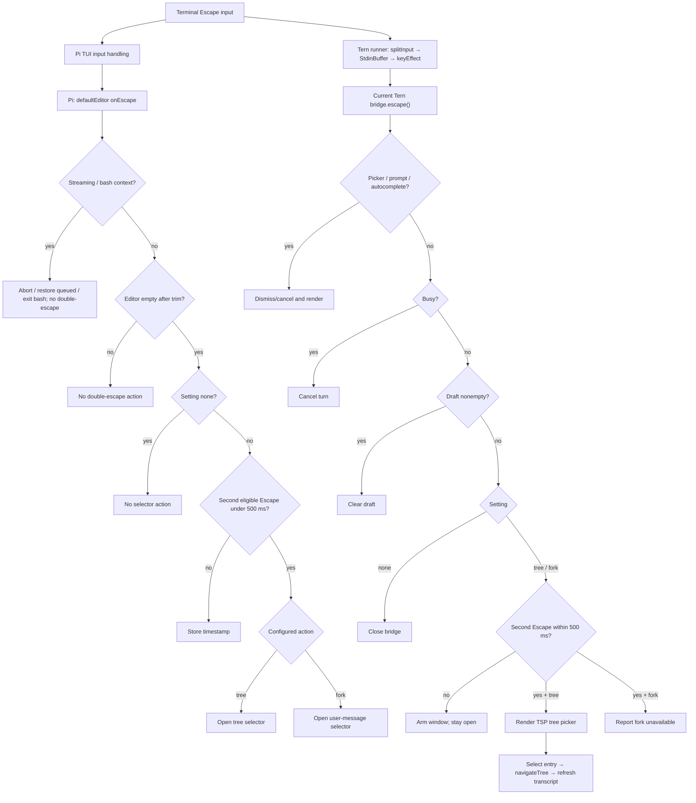

# Pi Escape-Escape behavior mapped for Tern

This map compares the vendored Pi source with the current local Tern runner/bridge. The implementation status is updated below.

## Source and scope

- Pi source: `vendor/pi-mono/packages/coding-agent/src/modes/interactive/interactive-mode.ts` (vendored source; this checkout's vendored snapshot). Key handler at lines 2424–2453; configured default at `vendor/pi-mono/packages/coding-agent/src/core/settings-manager.ts:1086-1093`; setting UI at `vendor/pi-mono/packages/coding-agent/src/modes/interactive/components/settings-selector.ts:281-285`.
- Tern implementation: `.pi/lib/tern/run.ts`, `.pi/lib/tern/keys.ts`, `.pi/lib/tern/bridge.ts` (working-tree implementation; inspect current diff before treating as committed).
- Tern SDK capture is pinned to `stencil-hq/tern-sdk` commit `38a4c06224a32ae81d1c7af67b1b386422f3fc7b`; see `docs/reference/tern-sdk/SOURCE-MANIFEST.md`. The captured SDK documentation is not Pi's double-escape implementation.
- Excludes Pi's full selector contents, Tern host internals, and rendering by the installed Tern host. The PTY verification below exercises the real runner against a small TSP protocol peer, not Tern's renderer.

## Pi behavior (source-confirmed)

Pi attaches `defaultEditor.onEscape`. Escape is context-sensitive, in precedence order: streaming restores queued messages and aborts; active bash is aborted; bash mode clears/exits bash; otherwise, only an empty/whitespace editor enters double-Escape detection. For that case, setting `doubleEscapeAction` defaults to `tree`; `none` disables the action. Two Escape callbacks within 500 ms open the tree selector (`tree`) or user-message/fork selector (`fork`); a successful double press resets timestamp. A first press records time. A non-empty editor does not enter this branch. See `interactive-mode.ts:2427-2452` and settings lines above.

Pi's help text presents the key as the configured clear key “twice” to exit (`interactive-mode.ts:639-641`), but the observed callback's actual behavior for configured action `tree` is to invoke the tree selector. “Exit” in that hint is not consistent with the implementation branch and must not be used as the behavior specification.

## Current Tern behavior (source-confirmed)

The runner splits TSP protocol messages from key bytes, gives keys to `StdinBuffer`, maps each complete sequence via `keyEffect`, and dispatches each Escape to `bridge.escape()` (`run.ts:58-74,118-129`). The mapper recognizes one complete Escape sequence; it does not itself combine consecutive presses (`keys.ts:20-38`). The runner's 50 ms held-prefix timeout relates to splitting possible TSP APC prefixes, distinct from Pi's 500 ms double-Escape window (`run.ts:48,122-129`).

Bridge Escape keeps its priority order: dismiss picker, cancel extension UI/ask dialog, close autocomplete, cancel a running turn, clear a nonempty draft. Idle empty-editor Escape now honors the Pi setting (default `tree`): the first press arms a 500 ms window and the second opens a TSP session-tree picker; setting `none` preserves the previous close behavior. If setting is `fork`, Tern reports that the fork selector is unavailable. Tree selection invokes Pi `navigateTree` without branch summarization; after the `session_tree` event the visible transcript is reconstructed from the selected session branch. See `.pi/lib/tern/bridge.ts` (current implementation).

## Implementation mapping and boundaries

The runner continues parsing complete sequences so Kitty CSI-u printable keys are not mistaken for Escape. The bridge applies double-Escape only after existing modal, busy-turn, and nonempty-draft handling. Tern's tree picker supports TSP select/activate, Up/Down, Enter, and Escape; navigation errors are surfaced in the transcript. `fork` is explicitly unsupported because the exposed live `AgentSession` interface has no fork operation in this bridge; no fake fork behavior is presented. This implementation also omits Pi's branch-summary prompt and uses `navigateTree(targetId)` without summary options.

## Mermaid flow

## SVG

`docs/reference/tern-esc-esc-map.svg` is a static visual companion to the current sourced flow. It marks the supported tree path and unsupported fork setting.

## Verification and unresolved points

- Manual end-to-end verification used `node --experimental-strip-types .pi/lib/tern/run.ts` in a PTY, an isolated `PI_CODING_AGENT_DIR`, and a protocol peer that answered TSP `hello` and frame acknowledgements. Two idle Escapes opened a serialized `session-tree-picker`; Escape emitted a delete for that picker; re-opening and activating a visible session entry produced `Navigated to selected session point` while the runner stayed alive.
- The same PTY flow sent Kitty CSI-u `ESC[114u`; the composer frame contained `"text":"r"`. A following Escape cleared the draft without opening the session tree. This checks the complete-sequence near-miss through the real runner input path.
- Actual host rendering was also exercised in an isolated headless `tern serve` session on Tern 0.6.2 (`tern ctl tree` queried the rendered UI tree). A temporary launcher and dedicated `PI_CODING_AGENT_DIR` were created under `.local`; each runner's exit trap removed its agent directory, then the exact launcher was removed and the headless server was quit. Default double-Escape rendered the Session tree picker and its Navigate/Cancel actions; a following Escape dismissed it. Typing `r` then pressing Escape cleared the draft without opening the picker. The control-driven launch also showed `Warning: conflict: shell block changed; edit manually`; its cause was not established and it was not treated as evidence for or against Escape behavior.
- With a temporary agent-dir `settings.json` setting `doubleEscapeAction: "none"`, one Escape closed the runner. With `"fork"`, two Escapes rendered the explicit “fork selection is not available” message. The project `.pi/settings.json` had no `doubleEscapeAction` value during these probes; project settings override global settings when present (`settings-manager.ts:118-134,292`). No user settings file was edited.
- `node --experimental-strip-types --check` passed for `bridge.ts` and `run.ts`, and the SVG parsed as XML. Focused `npx tsc --noEmit ... .pi/lib/tern/bridge.ts` did not pass: it reports type errors in the untouched `extensions/ask-user/src/remote-ask.ts`; the captured diagnostics contained no `bridge.ts` or `run.ts` errors.
- No unit tests were added or run.
- Confirmed source facts are scoped to checked-in Pi vendor and current local Tern files, not upstream latest versions.
- Not established: behavior in the user's ordinary desktop Tern window, busy-turn/modal precedence end to end, a project-level setting overriding a global setting end to end, Kitty CSI-u input through Tern's own keyboard frontend, Pi's full selector/branch-summary behavior, or other terminal-specific Escape timing.
- Focused relevant existing source checks: Pi handler, settings getter/UI, Tern complete-sequence input path, key mapper, and bridge Escape precedence.
